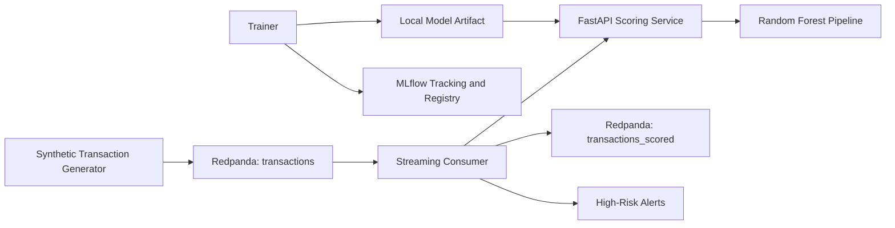

# Real-Time Fraud Detection Pipeline

An end-to-end, containerized machine-learning system that generates synthetic payment transactions, streams them through a Kafka-compatible broker, scores them through a FastAPI service, and publishes the results for downstream monitoring and alerting.

The project demonstrates how model training, experiment tracking, API serving, event streaming, automated testing, and CI/CD can work together as one reproducible system.

## What the System Does

- Generates synthetic transaction events for training and live simulation.
- Trains a scikit-learn `RandomForestClassifier` using a reusable preprocessing pipeline.
- Tracks ROC-AUC and average precision in MLflow and registers the trained model.
- Serves real-time fraud probabilities through a validated FastAPI endpoint.
- Consumes transaction events from Redpanda, calls the scoring API, and publishes results to a scored-transactions topic.
- Emits a console alert when a transaction receives a fraud probability of at least `0.80`.
- Runs the complete local environment through Docker Compose.
- Executes automated tests and Docker image builds through GitHub Actions.

## Architecture



## Technology Stack

| Area | Technologies |
|---|---|
| Language and data | Python, pandas, NumPy |
| Machine learning | scikit-learn, Random Forest, joblib |
| Experiment tracking | MLflow |
| API | FastAPI, Pydantic, Uvicorn |
| Streaming | Redpanda, Kafka-compatible producer and consumer |
| Infrastructure | Docker, Docker Compose |
| Testing and CI | pytest, FastAPI TestClient, GitHub Actions |

## Project Showcase

### Containerized services and live scoring

The Docker Compose environment runs Redpanda, MLflow, the transaction generator, model trainer, FastAPI service, and streaming consumer. The logs show the API continuously processing `POST /predict` requests.


### Interactive scoring API

FastAPI generates interactive OpenAPI documentation for the `POST /predict` endpoint.


### Transaction request and prediction response

The API validates transaction features and returns the transaction identifier, fraud probability, and binary fraud classification.


### MLflow experiment tracking

Training runs are tracked in MLflow, including evaluation metrics, artifacts, source information, and the registered `fraud_model` version.


## Services

| Service | Purpose | Port |
|---|---|---|
| `redpanda` | Kafka-compatible event broker | `9092` |
| `mlflow` | Experiment tracking and model registry | `5000` |
| `trainer` | Trains, evaluates, logs, and exports the model | — |
| `api` | Serves real-time predictions | `8000` |
| `generator` | Publishes synthetic transactions | — |
| `stream` | Scores events and publishes enriched results | — |

## Quick Start

### Prerequisites

- Docker Desktop or Docker Engine
- Docker Compose v2

### Start the complete system

```bash
docker compose up --build
```

After the services start:

- FastAPI documentation: <http://localhost:8000/docs>
- MLflow interface: <http://localhost:5000>
- Redpanda broker: `localhost:9092`

The first build can take several minutes while the images install their dependencies and MLflow initializes its local tracking database.

### Retrain the model

```bash
docker compose run --rm trainer
```

The default training service generates `25,000` labelled synthetic transactions, logs the run to MLflow, registers the model, and exports the fitted pipeline to the shared `artifacts` directory.

## API

### `POST /predict`

The endpoint accepts transaction, merchant, device, location, channel, velocity, and risk-indicator fields.

Example response:

```json
{
  "transaction_id": "demo-high-risk",
  "fraud_probability": 0.4533333333333333,
  "is_fraud": false
}
```

`is_fraud` becomes `true` when the predicted probability is at least `0.50`. The streaming consumer uses the higher threshold of `0.80` for high-risk console alerts.

## Testing

Install the project locally and run:

```bash
pip install -r requirements.txt
pip install -e .
pytest -q
```

The test suite verifies:

- Feature preprocessing produces finite, correctly shaped output.
- Synthetic labels remain binary.
- The API loads a fitted model and returns a valid probability.
- The prediction endpoint responds successfully to a valid transaction.

## Continuous Integration

The GitHub Actions workflow runs on pushes and pull requests. It:

1. Installs the Python dependencies.
2. Runs the pytest suite.
3. Builds the API, trainer, generator, and streaming-consumer Docker images after the tests pass.

## Project Structure

```text
.
├── .github/workflows/ci.yml
├── docker/
│   ├── Dockerfile.api
│   ├── Dockerfile.generator
│   ├── Dockerfile.stream
│   └── Dockerfile.train
├── scripts/
│   ├── consume_and_score.py
│   ├── generate_transactions.py
│   └── train.py
├── src/fraud/
│   ├── api/main.py
│   ├── config.py
│   ├── data.py
│   ├── features.py
│   ├── model.py
│   └── streaming.py
├── tests/
│   ├── test_api.py
│   └── test_features.py
├── docker-compose.yml
├── pyproject.toml
└── requirements.txt
```

## Design Decisions

- **Redpanda:** Provides a lightweight Kafka-compatible broker for local development.
- **FastAPI and Pydantic:** Provide typed request validation and interactive API documentation.
- **Reusable scikit-learn pipeline:** Keeps categorical encoding, numerical scaling, training, and inference consistent.
- **MLflow:** Records evaluation metrics and model artifacts while maintaining a registered model version.
- **Docker Compose:** Creates a repeatable multi-service development environment with one command.
- **Separate services:** Keep generation, training, scoring, and stream processing independently maintainable.

## Current Limitations

This is a portfolio demonstration built with synthetic data rather than a production banking dataset. The current model is a baseline, and its recorded metrics should not be interpreted as production performance.

A production implementation would also require authentication and authorization, encrypted secret management, durable artifact storage, schema governance, monitoring, drift detection, and stronger retry and failure-handling policies.

## Future Improvements

- Add model calibration, threshold tuning, and class-imbalance experiments.
- Load approved model versions directly from the MLflow registry.
- Add retry queues, dead-letter handling, and idempotency controls.
- Introduce structured logging, metrics, distributed tracing, and drift monitoring.
- Add API authentication, rate limiting, and secrets management.
- Replace local artifacts and SQLite tracking with managed storage and a production database.

## Disclaimer

This project uses generated transactions for educational and portfolio purposes. It does not process real cardholder information and is not intended for production financial decision-making.
